Foundation · Solve problems

# Lecture 1 · Fundamentals

These are the companion lecture notes for Lecture 1. They follow the slides you saw in class, keep the original cases, quotations and figures, and add the readings and the AI sparring guidance for review after class.

## Opening: Three Questions

Before any theory, three questions. Write down your honest answer before reading on.

### Thing One: How to Get Rich?

:::: {.portrait-split}
::: {.portrait-figure}
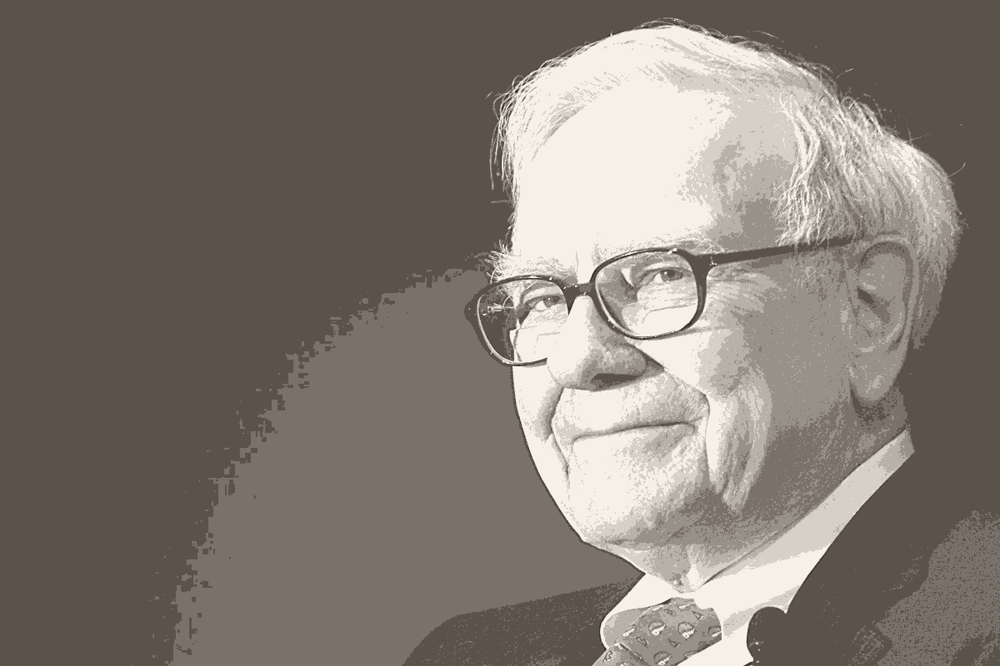
:::

::: {.portrait-body}
*Advice on wealth is everywhere — whose map should you trust?*

::: {.callout-tip appearance="minimal" icon="false"}
## ✎ Slow Note

Before we begin, write down your honest answer. No phones, no laptops. Just you and your brain.
:::
:::
::::

### Thing Two: Predicting the Stock Market

:::: {.portrait-split}
::: {.portrait-figure}

:::

::: {.portrait-body}
*Forecasting the market — genuine skill, or a crystal ball?*

::: {.callout-tip appearance="minimal" icon="false"}
## ✎ Slow Note

Can economics help you beat the market? Write your gut reaction.
:::
:::
::::

### Thing Three: How to Find a Good Job?

:::: {.portrait-split}
::: {.portrait-figure}
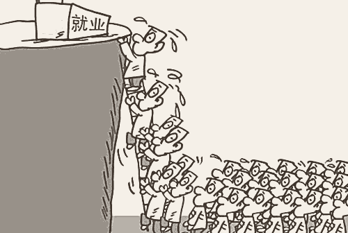
:::

::: {.portrait-body}
*Everyone is queuing for the 'good job' — but what makes it good?*

::: {.callout-tip appearance="minimal" icon="false"}
## ✎ Slow Note

What's your strategy? Write it down before we discuss.
:::
:::
::::

## Possible Unpleasant Consequences

::: {.callout-note appearance="simple" icon="false"}
## Daron Acemoglu（达龙·阿西莫格鲁）· MIT · Nobel Prize in Economic Sciences（诺贝尔经济学奖）

:::: {.portrait-split}
::: {.portrait-figure}

:::

::: {.portrait-body}
> "Managers with a business degree ('business managers') **reduce their employees' wages**. Within five years of the appointment of a business manager, wages decline by 6% and the labor share by 5 percentage points in the US, and by 3% and 3 percentage points in Denmark."

Firms that appoint business managers show no offsetting gains — no higher output, investment, or employment growth. The managers with a business degree **do not share the rents** with their workers.

**Source**: Acemoglu, D., He, A. X., & le Maire, D. (2022). "Eclipse of Rent-Sharing: The Effects of Managers' Business Education on Wages and the Labor Share in the US and Denmark."（forthcoming at *American Economic Review*）.
:::
::::
:::

So what *do* they learn in business school?

## What You Will Learn

Not formulas. Not tricks.

**A way of thinking** about decisions — in firms, families, and clubs.

## Opening Discussion: Help Bob Choose the Right Road Map

**Help Bob choose the right road map.** Bob lives in Beijing and plans to drive to Shanghai to visit his friends for the first time, to celebrate the Spring Festival. Bob uses Baidu / GaoDe map. The map provides either a satellite view or a simple street view. **Which view will Bob choose? Why?**

This leads to the core of the lecture: economic theory is like a road map — it uses simplifying assumptions to give you insight into complex real-world problems.

::: {layout-ncol=2}
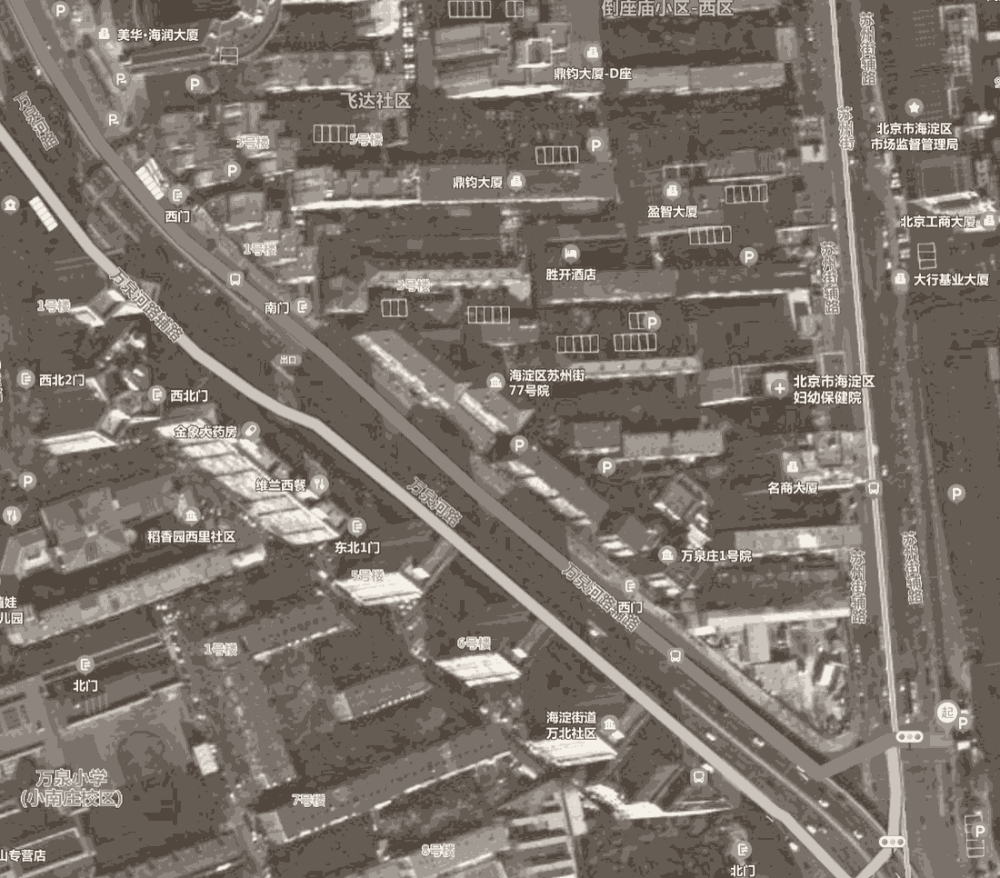{fig-align="center"}

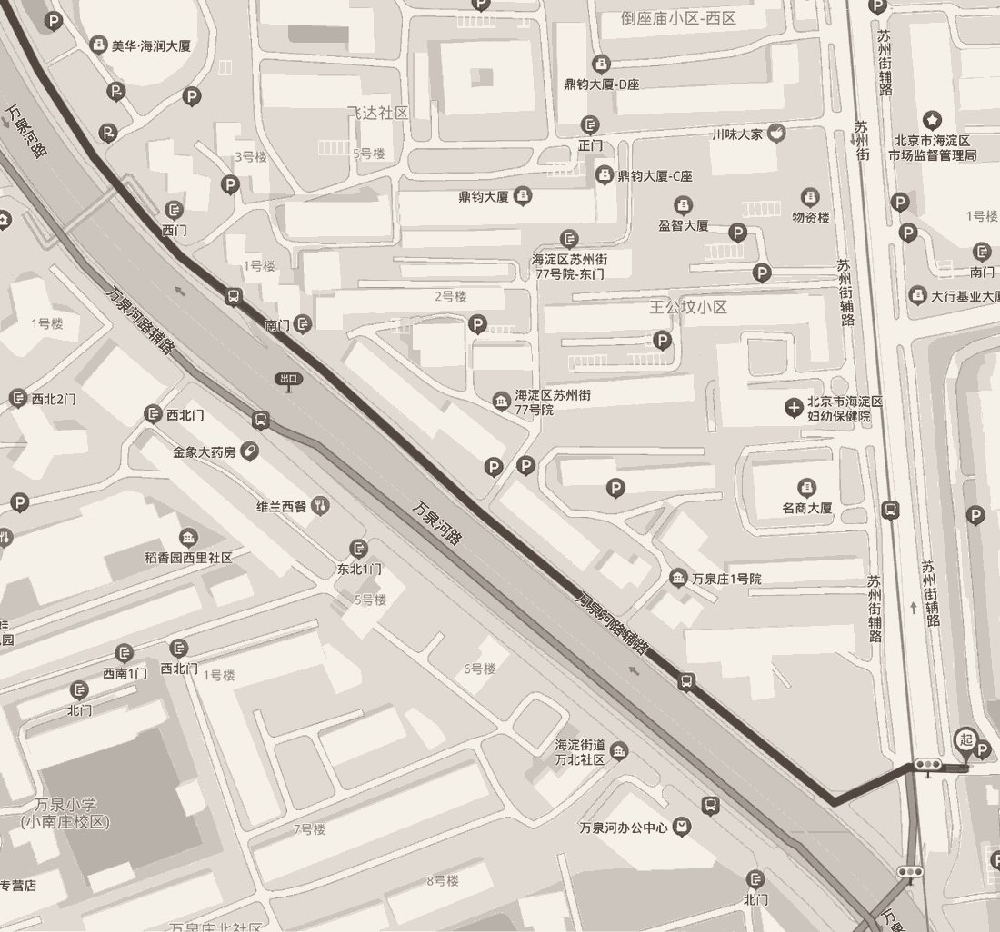{fig-align="center"}
:::

::: {.callout-tip appearance="minimal" icon="false"}
## ✎ Slow Note

Write your choice and your reason. We'll vote anonymously.
:::

::: {.callout-important appearance="simple" icon="false"}
## Anonymous Vote — Which Map?

- **A**: Satellite view (more detail, more "real")
- **B**: Simple street view (less detail, more useful)

*No wrong answers. We want your judgment, not a Google search.*
:::

## Learning Objectives

- Understand the positioning of managerial economics as a bridge between economic theory and managerial decisions — and its birth as a critique of its mother discipline (Joel Dean, 1951).
- Master the three-layer "capability pyramid."
- Build the methodological intuition that "economic theory is a simplifying map" — and see that which simplifications are useful is itself a question in the history of economics (Marshall, Polanyi, Krugman).
- Grasp the basic ideas of opportunity cost and marginal analysis, and the debate over whether opportunity cost is subjective (Wieser), unknowable (Knight), or merely ignored by real humans (Thaler).
- Distinguish economic profit from accounting profit, and profit maximization from firm-value maximization (time value of money, discounting).
- Understand incentives inside the firm: the principal–agent problem, moral hazard, adverse selection, and the design of contracts.
- Recognize what a market is — and why markets exist to reduce transaction costs.

## Core Conceptual Framework

### 1. The Capability Pyramid

| Layer | Capability | Description |
|---|---|---|
| Top | Anticipate and solve problems | Strategic thinking, leadership, innovation — formulate strategy before problems emerge |
| Middle | Detect and solve problems | Observation, analysis, teamwork — intervene before problems escalate |
| Foundation | Solve problems | Quick response, adaptation, basic decisions — correct rapidly after problems occur |

### 2. What Is Managerial Economics?

**Manager + Economics = Managerial Economics**

- **Manager**（管理者）: a person who directs resources / behavior of individuals to achieve a stated goal — directing the efforts of others, purchasing inputs, making decisions on price, quality, innovation.
- **Economics**（经济学）: the science of making decisions / allocating resources in the presence of scarce resources（稀缺资源）.
  - Microeconomics: individual behavior
  - Industrial Organization: structure of firms and industries
- **Managerial Economics**（管理经济学）: the study of how to direct scarce resources in the way that most efficiently achieves a managerial goal.

#### A Course Born in 1951

::: {.callout-note appearance="simple" icon="false"}
## Joel Dean（乔尔·迪恩）· New York, 1951 · *Managerial Economics*（《管理经济学》）, Preface — the book that named this course

> "The purpose of this book is to show how economic analysis can be used in formulating business policies. It is therefore a departure from the main stream of economic writings on the theory of the firm, much of which is **too simple in its assumptions and too complicated in its logical development to be managerially useful**."

The discipline was born as a **critique of its mother discipline**:

- The received price theory was not usable by real managers.
- Erich Gutenberg's *Grundlagen der Betriebswirtschaftslehre* (1951) reorganized German business economics — a parallel naming moment.
- Behind both: the rise of the modern corporation (Berle & Means, 1932), which created the "manager" as a distinct decision-maker worth studying.

**Source**: Dean, J. (1951). *Managerial Economics*（《管理经济学》）. New York: Prentice-Hall. ｜ Berle, A. A., & Means, G. C. (1932). *The Modern Corporation and Private Property*. New York: Macmillan.
:::

#### Three Theories of the Firm: Machlup's Map

::: {.callout-note appearance="simple" icon="false"}
## Fritz Machlup（弗里茨·马赫卢普）· Princeton, 1967 · "Theories of the Firm: Marginalist, Behavioral, Managerial"

*(Paraphrase, not quotation)* Machlup divided "theories of the firm" into **three branches, each built for a different explanatory purpose**:

| Branch | Firm is... | Built to answer |
|---|---|---|
| **Marginalist** 边际主义 | a profit-maximizing calculator | How do markets allocate resources? (price/output theory) |
| **Behavioral** 行为主义 | a coalition with limited rationality | How do organizations actually decide? |
| **Managerial** 管理主义 | a growth-seeking team of managers | What do managers (not owners) want? |

His point: these are not rivals to be judged true/false, but **different maps for different journeys**.

**Source**: Machlup, F. (1967). "Theories of the Firm: Marginalist, Behavioral, Managerial." *American Economic Review*, 57(1), 1–33.
:::

#### Our Position: A Balance of Three

This course follows Machlup's map and tries to **balance the three** — no single branch owns the truth:

| Branch | Role in this course |
|---|---|
| **Marginalist** | Our **basic toolkit** — marginal analysis, opportunity cost, supply & demand (Baye; Mankiw) |
| **Behavioral** | Our **reality check** — bounded rationality, internal politics, what firms actually do (Simon; Cyert & March) |
| **Managerial** | Our **mirror of suspicion** — whose goals? whose growth? when does the firm serve its managers? (Baumol; Jensen & Meckling) |

::: {.callout-tip appearance="minimal" icon="false"}
## ✎ Slow Note

When a model in this course gives you an answer, ask Machlup's question: *which map produced this answer, and what did that map delete?*
:::

### 3. Why Do We Need Economic Theory?

> "I don't want ivory-tower theorizing; I want a practical solution!"

**NO** cookbook formulas for real-world problems.

**Theory** allows people to gain insights into complicated problems using simplifying assumptions.

Using economic theory is like using a **road map**: it simplifies business problems (pricing, advertising, investment…) to their most essential components.

This class provides a way of viewing complex real-world problems and thinking of practical solutions.

#### Not All Simplifications Are Useful

Managerial Economics will utilize a large part of useful simplifications out of economics.

But how do we know which simplifications are useful? That is a question about the **history of economics itself**.

#### The Tides, Not the Stars

::: {.callout-note appearance="simple" icon="false"}
## Alfred Marshall（阿尔弗雷德·马歇尔）· Cambridge, 1890 · *Principles of Economics*（《经济学原理》）, Book I, Ch. III §3

:::: {.portrait-split}
::: {.portrait-figure}
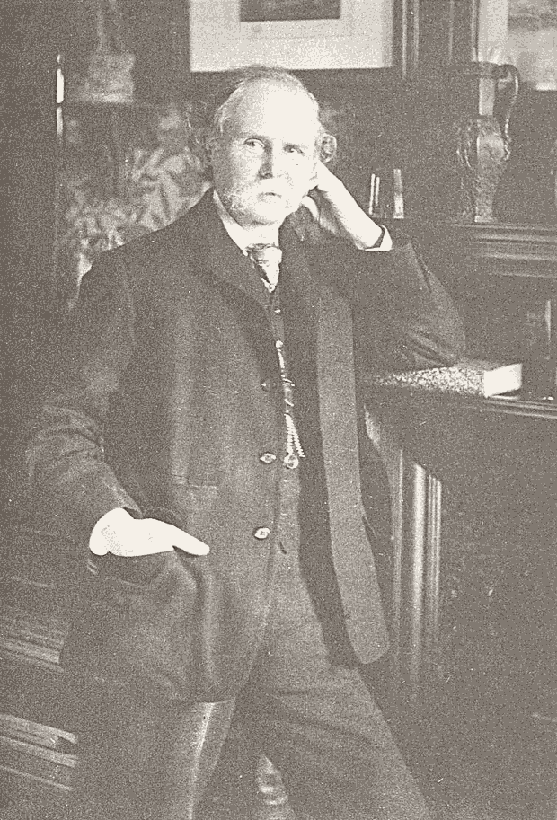
:::

::: {.portrait-body}
> "The laws of economics are to be compared with the laws of the **tides**, rather than with the simple and exact law of gravitation. For the actions of men are so various and uncertain, that the best statement of tendencies, which we can make in a science of human conduct, must needs be inexact and faulty."

**Source**: Marshall, A. (1920). *Principles of Economics*（《经济学原理》）(8th ed.). London: Macmillan.
:::
::::
:::

#### The Map, Not the Territory

::: {.callout-note appearance="simple" icon="false"}
## Michael Polanyi（迈克尔·波兰尼）· Manchester, 1958 · *Personal Knowledge*（《个人知识》）, p. 4

:::: {.portrait-split}
::: {.portrait-figure}

:::

::: {.portrait-body}
> "All theory may be regarded as a kind of **map** extended over space and time."

Polanyi — a physical chemist turned philosopher — argued that a map is not the territory it represents. A good map *deletes* most of reality so that we can navigate what matters. But the deletions are not neutral; they embody choices about what counts as important.

**Source**: Polanyi, M. (1958). *Personal Knowledge: Towards a Post-Critical Philosophy*（《个人知识：走向一种后批判哲学》）. Chicago: University of Chicago Press.
:::
::::
:::

#### The Great Dialogue: What Economics Is

::: {.callout-note appearance="simple" icon="false"}
## The Great Dialogue（思想史上的辩论）

:::: {.portrait-split}
::: {.portrait-figure}
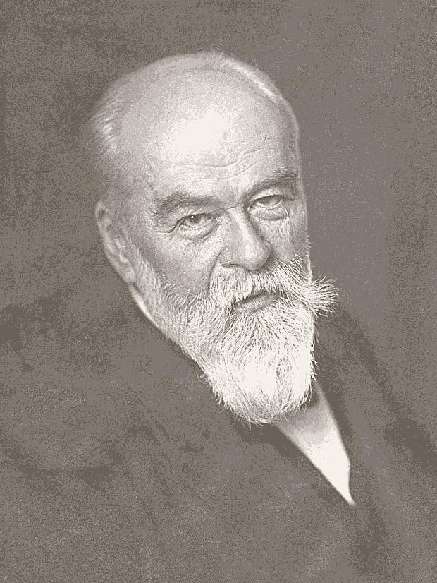
:::

::: {.portrait-body}
**German Historical School（德国历史学派）(Schmoller 施莫勒，1880s):**

> "Your 'economic man'（经济人）is a fiction! Real people are shaped by history, culture, institutions. Economics should describe, not deduce."

**Alfred Marshall（阿尔弗雷德·马歇尔）(Cambridge, 1885):**

> "Agreed — economics must study **man**, not just wealth. But we still need tools to *discover* truth, not just catalog facts."
:::
::::
:::

#### Marshall's Definition

::: {.callout-note appearance="simple" icon="false"}
## Marshall's Definition

> "Political Economy or Economics is a study of mankind in the **ordinary business of life**; it examines that part of individual and social action which is most closely connected with the attainment and with the use of the material requisites of wellbeing. Thus it is on the one side a study of wealth; and on the other, and **more important side**, a part of the study of **man**."

**Source**: Marshall, A. (1920). *Principles of Economics*（《经济学原理》）(8th ed.), Book I, Ch. II §1.
:::

Marshall dropped "Political" from "Political Economy" — a deliberate act of **rebranding** to free economics from party politics.

#### Economics: An Engine, Not a Body of Truth

::: {.callout-note appearance="simple" icon="false"}
## Economics: An Engine, Not a Body of Truth

> "Economic doctrine is not a body of concrete truth, but an **engine of discovery**（发现的引擎）of concrete truth."

**Source**: Marshall, A. (1885). "The Present Position of Economics"（《经济学的现状》）. In *Memorials of Alfred Marshall*（《马歇尔纪念文集》）(Pigou 庇古 ed., 1925), p. 159.
:::

An engine doesn't *give* you answers. It *helps you find* them.

#### 2008: When the Map Failed

::: {.callout-note appearance="simple" icon="false"}
## Paul Krugman（保罗·克鲁格曼）· Princeton, 2009 · NYT Magazine

:::: {.portrait-split}
::: {.portrait-figure}
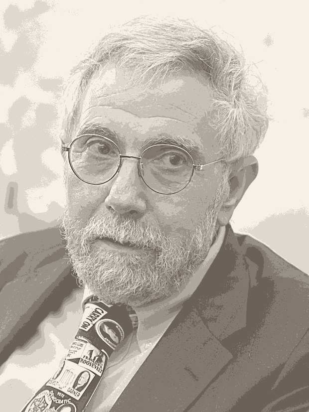
:::

::: {.portrait-body}
> "The economics profession went astray because economists, as a group, mistook **beauty**, clad in impressive-looking mathematics, for **truth**."

**Source**: Krugman, P. (2009, Sept. 6). "How Did Economists Get It So Wrong?"（《经济学家为何错得如此离谱？》）*The New York Times Magazine*.
:::
::::
:::

Question for you: *If the map failed in 2008, should we throw away maps — or make better ones?*

### 4. Managers Are Everywhere

| Where | Goal | Scarce Resource（稀缺资源） |
|-------|------|-----------------|
| Firm 企业 | Profits / firm value 利润／企业价值 | Capital, labor, time |
| Family 家庭 | Income / happiness / welfare | Time, money, attention |
| Club 社团 | Member satisfaction | Budget, space, volunteer hours |

::: {.callout-tip appearance="minimal" icon="false"}
## ✎ Slow Note

Think of one decision you made this week as a "manager" (of your time, your family, your team). What was the goal? What was the constraint?
:::

### 5. Principles of Effective Management

This course will help you in each step of your decision-making process — three principles form one framework:

| Principle | Key Question | Related Concepts |
|-----------|-------------|----------------------|
| 1. **Identify** goals and constraints（目标与约束） | What are we maximizing? | Firm value, short- vs. long-run, profit vs. value |
| 2. **Recognize** incentives and opportunity costs（激励与机会成本） | What are we giving up? | Opportunity cost debate, economic profit, principal-agent |
| 3. **Understand** markets and margins（市场与边际） | Where and how do we trade? | What is a market, marginal analysis, market structures |

Every managerial decision passes through all three procedures.

Almost no decision is made free of constraints. **Example**: How much time for studying Managerial Economics? What is the goal? What are the constraints?

## Opportunity Cost: The Great Debate

::: {.callout-note appearance="simple" icon="false"}
## Friedrich von Wieser（弗里德里希·冯·维塞尔）· Vienna, 1884 · Austrian School（奥地利学派）

:::: {.portrait-split}
::: {.portrait-figure}
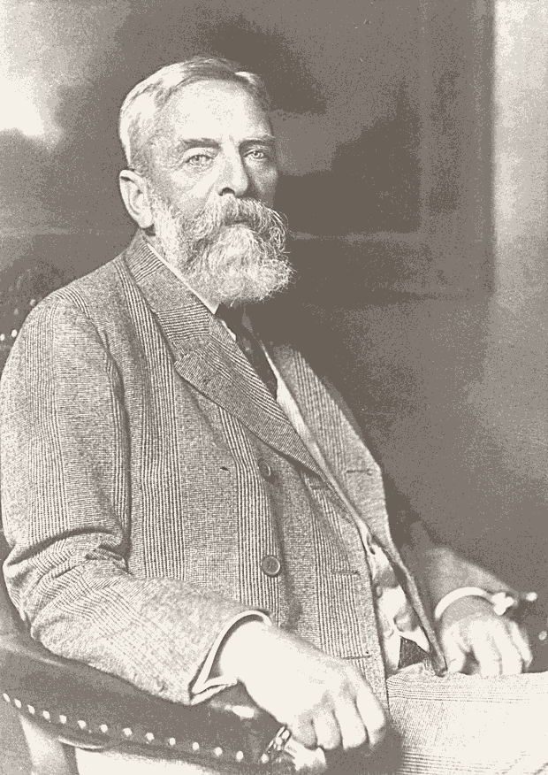
:::

::: {.portrait-body}
> Cost is not the labor embodied in a thing. Cost is the **utility you give up** — the value of the next-best alternative.

Wieser, a student of Carl Menger（卡尔·门格尔）, coined the term "opportunity cost"（机会成本）(*Opferkosten*, later "alternative cost"). Against the classical labor theory of value（劳动价值论）, the Austrian school argued that value — and therefore cost — is **subjective**, located in the mind of the chooser.

**Source**: Wieser, F. (1884). *Über den Ursprung und die Hauptgesetze des wirtschaftlichen Wertes*（《论经济价值的起源与基本规律》）. Vienna: Hölder.
:::
::::
:::

### Knight's Challenge: Whose Opportunity?

::: {.callout-note appearance="simple" icon="false"}
## Frank Knight（弗兰克·奈特）· Chicago, 1921 · *Risk, Uncertainty and Profit*（《风险、不确定性与利润》）

> Under true uncertainty, you cannot know what the "next-best alternative" even is. Opportunity cost（机会成本）becomes **unmeasurable** — and that is precisely where profit comes from.

Knight pushed back: if the future is genuinely uncertain (not just risky), then "the opportunity cost of this choice" is not a number you can look up. It is a judgment — perhaps a guess. The tension between "cost as a calculable number" and "cost as an unknowable sacrifice" is still with us.

**Source**: Knight, F. (1921). *Risk, Uncertainty and Profit*（《风险、不确定性与利润》）. Boston: Houghton Mifflin.
:::

### The Behavioral Twist

::: {.callout-note appearance="simple" icon="false"}
## Richard Thaler（理查德·塞勒）· Chicago, 1985 · *Marketing Science*（《营销科学》）

:::: {.portrait-split}
::: {.portrait-figure}
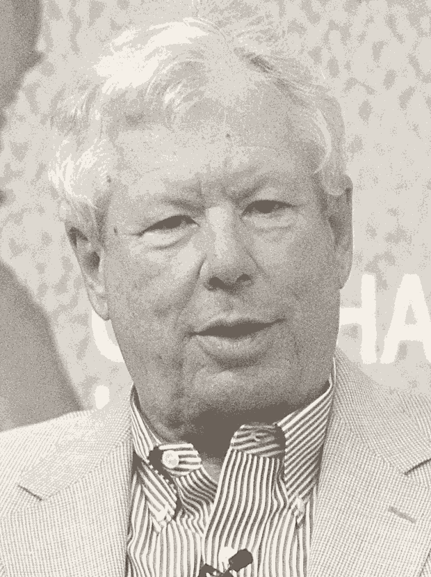
:::

::: {.portrait-body}
> People systematically **ignore** opportunity costs（机会成本）— even when they know better. Yet they obsess over **sunk costs**（沉没成本）— money already spent that can never be recovered.

Thaler's experiments showed that MBA students, trained in opportunity cost, still fall into the trap. The textbook says "consider what you give up." The brain says "but I already paid for it!" This gap between what we *know* and what we *do* is the most important finding in behavioral economics.

**Source**: Thaler, R. (1985). "Mental Accounting and Consumer Choice"（《心理账户与消费者选择》）. *Marketing Science*（《营销科学》）, 4(3), 199–214.
:::
::::
:::

### So What IS Opportunity Cost?

Four voices, four answers:

- **Textbook**: The value of the best foregone alternative.
- **Wieser（维塞尔）**: The utility you *subjectively* give up.
- **Knight（奈特）**: Often **unknowable** under true uncertainty.
- **Thaler（塞勒）**: Often **ignored** by real humans, even when knowable.

::: {.callout-tip appearance="minimal" icon="false"}
## ✎ Slow Note

Given all four voices, write YOUR working definition of opportunity cost. Not the textbook's. Yours.
:::

### Economic Profit vs. Accounting Profit

|  | Accounting Profit（会计利润） | Economic Profit（经济利润） |
|---|---|---|
| Formula | Revenue − Explicit costs（显性成本） | Revenue − Total opportunity cost（机会成本） |
| Includes implicit costs?（隐性成本） | No | Yes |
| On income statement? | Yes | No |
| Relationship | Economic ≤ Accounting |  |

**Opportunity cost**（机会成本）= explicit (accounting) cost + implicit cost of giving up the **best alternative use**.

### No Free Lunch

There is **NO FREE LUNCH**（天下没有免费的午餐）!

- Are the best things in life free?
- What about love, friendship, a sunset?
- *Even "free" things have an opportunity cost — your time, your attention.*

### Adam Smith: The Butcher, the Brewer, the Baker

::: {.callout-note appearance="simple" icon="false"}
## Adam Smith（亚当·斯密）· *The Wealth of Nations*（《国富论》）, 1776

:::: {.portrait-split}
::: {.portrait-figure}
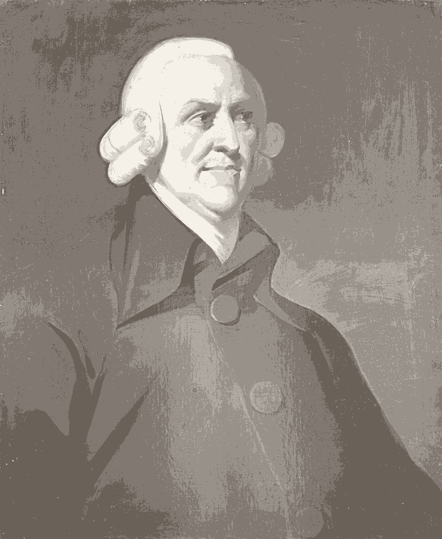
:::

::: {.portrait-body}
> "It is not from the benevolence of the butcher, the brewer, or the baker, that we expect our dinner, but from their regard to their own interest. We address ourselves, not to their humanity but to their **self-love**（自爱）…"

**Source**: Smith, A. (1776). *An Inquiry into the Nature and Causes of the Wealth of Nations*（《国富论》）, Book I, Ch. 2.
:::
::::
:::

By pursuing its self-interest（自利）, a firm meets the needs of society. Profits **signal** to resource holders where resources are most highly valued.

### The Adam Smith Problem

::: {.callout-note appearance="simple" icon="false"}
## Adam Smith（亚当·斯密）— The Puzzle · Edinburgh, 1759 vs. 1776

In *The Theory of Moral Sentiments*（《道德情操论》）(1759), Smith argued that humans are driven by **sympathy**（同情共感）— our ability to imagine ourselves in another's place. In *The Wealth of Nations*（《国富论》）(1776), he seems to argue that markets run on pure **self-interest**（自利）. Scholars call this the "Adam Smith Problem." Are there two Smiths — a moral philosopher and a cold economist?

**Source**: Smith, A. (1759). *The Theory of Moral Sentiments*. Smith, A. (1776). *Wealth of Nations*.
:::

### One Smith, Not Two

Smith never saw a contradiction. Markets require **both**:

- Self-interest（自利）drives us to produce what others want (**Wealth of Nations**).
- Sympathy（同情共感）keeps exchange fair and keeps us from exploiting others (**Moral Sentiments**).

The butcher serves your dinner not because he loves you — but because he understands what you want. That understanding *is* sympathy, redirected through the market.

## Marginal Thinking and Sunk Costs

### Quiz: The Honda Civic

You are selling your 2016 Honda Civic. You have already spent **2,000 Yuan** on repairs. At the last minute, the transmission dies. You can pay **1,000 Yuan** to have it repaired, or sell the car "as is."

Should you repair the transmission?

- **A.** Book value = 50,000 Yuan (works), 48,500 Yuan (doesn't)
- **B.** Book value = 50,000 Yuan (works), 49,500 Yuan (doesn't)

::: {.callout-tip appearance="minimal" icon="false"}
## ✎ Slow Note

Write your answer AND your reasoning. Then we'll discuss.
:::

::: {.callout-note collapse="true" icon="false"}
## Answers

**A**: Benefit of fixing = 50,000 − 48,500 = **1,500 Yuan** > 1,000 Yuan cost. **Fix it.**

**B**: Benefit of fixing = 50,000 − 49,500 = **500 Yuan** < 1,000 Yuan cost. **Don't fix it.**
:::

### Observations

- The 2,000 Yuan you already spent is a **sunk cost**（沉没成本）— irrelevant. Don't cry over spilled milk.
- What matters is the cost and benefit of the **marginal**（边际的）repair.
- The change in incentives from A to B caused your decision to change.

## Profit, Firm Value, and Time

The **value of a firm** is the present value of future profits.

- **Time Value of Money (TVM)**（货币的时间价值）: $1 of future profit < $1 of profit now.
- Investors face uncertainty about future profits.
- Value = sum of all **discounted**（贴现的）future profits:

$$V = \sum_{t=1}^{T} \frac{\pi_t}{(1+r)^t}$$

Where $\pi_t$ = profit in period $t$; $r$ = discount rate（贴现率）; $T$ = time horizon.

### Case: Tesla Valuation

Bob owns a car company, **Bosla**. He wants to buy **Tesla Corp.** to strengthen its electric car production line.

- How would you estimate Tesla's firm value?
- What determines the discount rate（贴现率）?
- What determines expected future profits?

### Maximize Profits or Firm Value?

- Only in special cases does maximizing single-period profit = maximizing firm value.
- When revenue and cost in one period are **independent** of future periods.
- **But in most scenarios**, today's decisions affect tomorrow's profits:
  - Learning by doing（干中学）
  - Wage cuts → lower productivity → lower future profits
  - Current production depletes future resources (mining, oil)

### Question: What Is "Profit"?

The goal we "maximize" depends on the organization — and the meaning of profit shifts with it:

| Organization | "Profit" = ? |
|---|---|
| Firm 企业 | Profits / firm value（利润／企业价值） |
| Individual 个人 | Happiness / utility（效用／幸福感） |
| Family 家庭 | Welfare of its members（家庭福祉） |
| Charity 慈善机构 | Social impact / mission fulfilled（社会影响） |
| Hospital 医院 | Patient health outcomes（患者健康） |
| School 学校 | Student learning & growth（学生成长） |

**Reflect**: If a hospital "maximizes profit," what does it sacrifice? If a school chases only rankings, what is the opportunity cost? Is there a universal definition of profit — or does the very meaning shift with the mission?

## Incentives and the Principal–Agent Problem

Do managers care more about profits or firm value? **The Principal-Agent Problem**（委托代理问题）.

### The Principal-Agent Problem

| Role | Who |
|---|---|
| **Principal**（委托人） | Large business owner (shareholders) |
| **Agent**（代理人） | Executive management team |

**Pros**: Professional managers are more experienced → increase firm value.

**Cons**: Managers behave opportunistically → decrease firm value.

**Two conditions**: (1) Manager's objectives differ from owner's; (2) Monitoring is too costly.

### The Principal-Agent Problem Is Everywhere

Whenever one person acts for another — and interests differ, and the act is hard to see:

| Principal（委托人） | Agent（代理人） | What the agent can hide |
|---|---|---|
| Shareholders 股东 | CEO 高管 | Effort, strategy, self-dealing |
| Patient 患者 | Doctor 医生 | Whether a test or drug is truly needed |
| Car owner 车主 | Mechanic 汽修店 | Whether the part really had to be replaced |
| Home seller 房主 | Real-estate agent 房产中介 | The true market price; effort to bargain |
| Investor 投资人 | Fund manager 基金经理 | The risk taken with "other people's money" |
| Insurer 保险公司 | Insured 投保人 | Care taken *after* the policy is signed |
| Voter 选民 | Official 官员 | Effort, honesty, hidden favors |

::: {.callout-tip appearance="minimal" icon="false"}
## ✎ Slow Note

In which row does the agent know more than the principal — and which row is *yours*?
:::

### Two Ways to Hide: Zhangzidao (獐子岛) and Luckin Coffee (瑞幸咖啡)

::: {.callout-note appearance="simple" icon="false"}
## Case 1 — Zhangzidao: "The Scallops Ran Away"（扇贝跑路）

A listed seafood company reported massive losses, claiming its scallops perished due to a *cold water mass (冷水团)*. Yet this "asset" lies on the seabed — **invisible to investors**.

- 2014: "the scallops died"; 2018: "the scallops starved" — the narrative kept shifting
- Regulators later uncovered *falsified accounting records*; the chairman received a lifetime market ban.
:::

::: {.callout-note appearance="simple" icon="false"}
## Case 2 — Luckin Coffee (2020)

Firm management admitted fabricating approximately ¥2.2 billion in sales revenue.

- Short-seller (做空机构) Muddy Waters (浑水) recruited more than 1,400 investigators to film and count customer traffic across 981 stores
- **Privatizing the monitoring** that dispersed shareholders could not conduct on their own.
:::

::: {.callout-tip appearance="minimal" icon="false"}
## ✎ Slow Note

Both cases feature hidden corporate actions. Which is more difficult to regulate: an asset you cannot physically observe, or accounting numbers you cannot independently verify? Who ultimately bears the cost of monitoring?
:::

### Case: Bob's Restaurant

Bob opened a restaurant and hired a manager. Recently, Bob reported he had been **losing money** ever since the restaurant opened. When asked whether the manager was doing a good job, he said:

> "For the 400,000 Yuan salary I pay the manager each year, the manager should be doing a good job."

::: {.callout-tip appearance="minimal" icon="false"}
## ✎ Slow Note

What is the problem here? Is it the manager's fault, Bob's fault, or neither?
:::

### Hidden Actions and Moral Hazard

Managers can take **hidden actions**（隐藏行为）that cannot be observed by owners for any feasible amount of monitoring effort.

**Moral hazard**（道德风险）: a type of principal-agent problem where managers take hidden actions that harm the owner's interests.

What incentive plans could Bob design?

### A Map of Asymmetric Information

Hidden information is the engine behind every agency problem. Sort it by two questions:

| When is it hidden? | What is hidden? | The problem | Classic reading |
|---|---|---|---|
| **Before** the contract | **Information**（信息） | **Adverse selection**（逆向选择） | Akerlof (1970), *The Market for Lemons* |
| **After** the contract | **Action**（行为） | **Moral hazard**（道德风险） | Holmström (1979), *Moral Hazard and Observability* |

Markets then respond in two ways:

- **Signaling**（信号传递）: the *informed* party proves its type — Spence (1973)
- **Screening**（甄别）: the *uninformed* party designs a menu to sort types — Rothschild & Stiglitz (1976)

### Information Economics: Three Nobel Ideas

| Idea | The argument | A question to carry |
|---|---|---|
| **The Market for Lemons**（柠檬市场）· Akerlof, 1970 | If buyers cannot tell good from bad, the bad drives out the good | Is the used-car market (瓜子、优信) really fixing this? |
| **Job-Market Signaling**（劳动市场信号）· Spence, 1973 | Education can pay off as a *signal* of ability, not only as skill | Is your MBA a skill, a signal — or both? |
| **Screening**（甄别）· Rothschild & Stiglitz, 1976 | Insurers offer menus (e.g., deductibles) to sort low- and high-risk | Why must *you* pay the first ¥1,000 of a claim? |

Akerlof, Spence and Stiglitz shared the **2001 Nobel Prize** for "analyses of markets with asymmetric information."

### Contract Theory: Pay for What You Can See

You cannot pay for effort you cannot observe — so you pay for the best *observable* proxy.

- **Informativeness principle**（信息量原则）— Holmström, 1979: reward on any signal informative about effort, even a noisy one
- **Agency costs**（代理成本）— Jensen & Meckling, 1976: monitoring + bonding + residual loss
- **Incomplete contracts**（不完全契约）— Grossman & Hart (1986), Hart & Moore (1990): when contracts cannot foresee everything, **who owns the asset** decides the outcome

Holmström and Hart won the **2016 Nobel Prize** for contract theory. A Chinese precedent: **晋商“身股制”（body shares）** (around 130 years ago) — a Piaohao（票号, old banks）manager took a share of profit without contributing capital, an incentive contract centuries before stock options.

::: {.callout-tip appearance="minimal" icon="false"}
## ✎ Slow Note

If you cannot observe effort, is it fair to punish bad outcomes? Should CEOs be paid in stock — or does that just make them gamble?
:::

### Think & Debate

::: {.callout-important appearance="simple" icon="false"}
## Anonymous Vote — Which is the best way to pay a CEO?

- **A**: High fixed salary（高薪）— stable, but weak link to performance
- **B**: Stock and options（股权激励）— strong link, but invites short-termism and gambling
- **C**: Long-run bonus tied to multi-year value（长期激励）— harder to measure, easier to game

*No single right answer — defend your choice with the theory you just met.*
:::

**Sharper questions to take home**

- You cannot observe a teammate's effort — should group work still be graded by the outcome?
- Insurance pays for your losses; does that quietly change how carefully you act?
- When an AI agent books, buys, and negotiates for you — **who is the principal, who is the agent, and what is the contract?**

## What Is a Market?

::: {layout-ncol=3}
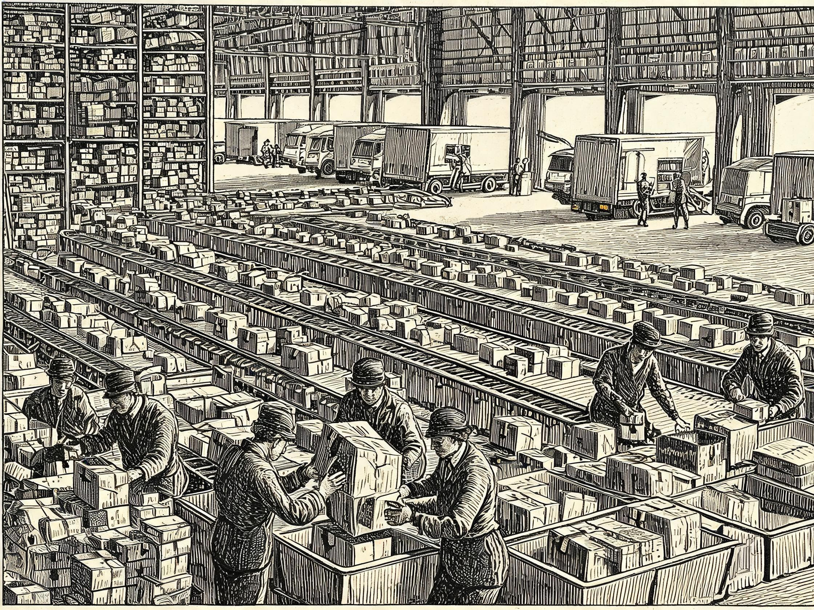

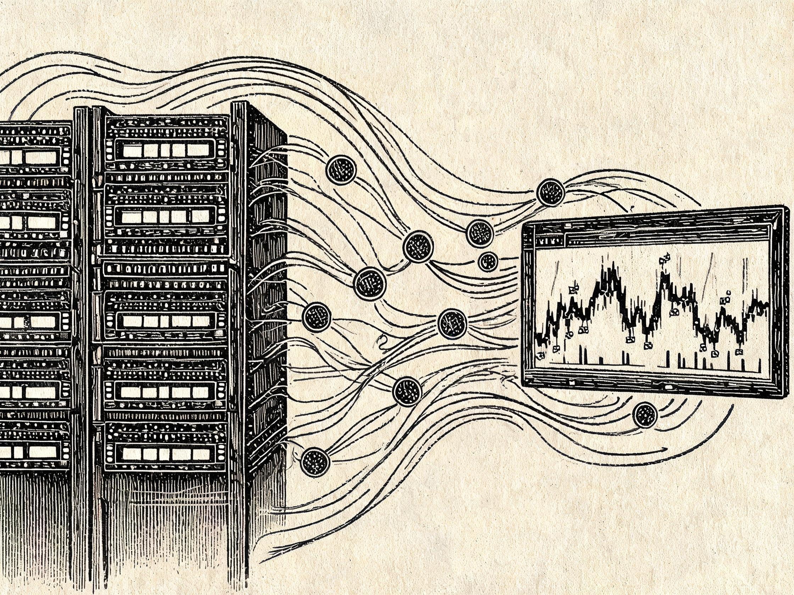

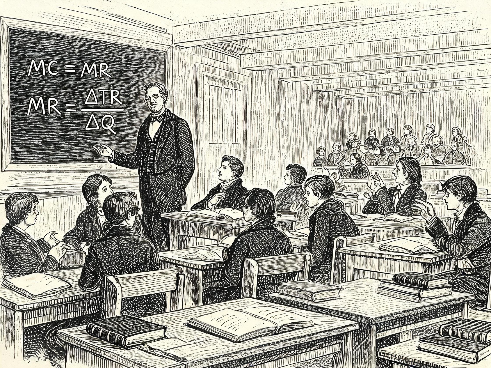
:::

**Market**（市场）— perhaps the most important invention of humankind.

- Any arrangement through which buyers and sellers exchange goods or services.
- A **wide** concept beyond one's usual imagination — from JD.com to AI tokens to this very classroom.
- Markets are arrangements to **reduce transaction costs**（交易成本）(searching, purchasing).

### Coase: The Market for Goods and the Market for Ideas

::: {.callout-note appearance="simple" icon="false"}
## Ronald Coase（罗纳德·科斯）· Chicago, 1974 · "The Market for Goods and the Market for Ideas"（《商品市场与思想市场》）

:::: {.portrait-split}
::: {.portrait-figure}
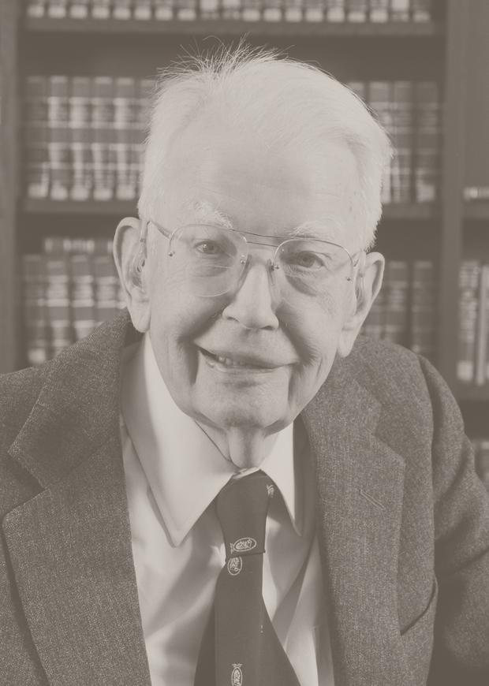
:::

::: {.portrait-body}
Economists who extol the virtues of the market for goods often distrust the market for ideas — yet the same economic principles govern both. "If competition allocates goods efficiently, why assume it fails for knowledge?"

**Source**: Coase, R. H. (1974). "The Market for Goods and the Market for Ideas." *American Economic Review*, 64(2), 272–274. Photo: University of Chicago Law School（芝加哥大学法学院）· Wikimedia Commons.
:::
::::
:::

### The Market for Ideas

- Coase exposed a striking **asymmetry**（不对称）: economists champion free markets for bread, steel, and labor, yet many endorse regulation, subsidy, or gatekeeping in the "marketplace of ideas"（思想市场）— universities, media, scientific communities.
- The market for ideas is itself a **market** — with entry barriers, transaction costs, and the same logic of exchange. Schools, journals, platforms, LLM chats: all are markets where knowledge is produced, exchanged, and refined through competition.

**Reflect**: Is this classroom a market? If so, what is being "traded"? What are the transaction costs of learning — and who bears them?

## Rational People Think at the Margin

- **Marginal Benefit (MB)**（边际收益）: change in total benefits from a change in the choice variable.
- **Marginal Cost (MC)**（边际成本）: change in total costs from a change in the choice variable.
- **MB = MC** maximizes profits / net benefits / firm value.

### Case: American Airlines

**Robert Crandall**（罗伯特·克兰德尔）, President and CEO of American Airlines (1985–1998).

In the 1980s, Crandall introduced an innovative pricing model and seat allocation system.

- A significant portion of operating costs are **fixed**（固定成本）(aircraft, salaries, maintenance, fuel).
- Variable costs（可变成本）(meals, baggage) are a small percentage.
- As long as ticket price > marginal cost (primarily the meal), the seat should be sold.

## Summary

Managerial Economics offers a **way of thinking** about managerial problems.

- The core economic theory is **simple yet powerful** — but right application needs **training** and **practice**.
- Core concepts: opportunity costs（机会成本）, economic profits（经济利润）, short-run vs. long-run（短期与长期）, market structures（市场结构）, marginal analysis（边际分析）.

## Key Terms

| Term | Definition |
|---|---|
| Managerial Economics（管理经济学） | The study of how to direct scarce resources in the way that most efficiently achieves a managerial goal |
| Opportunity Cost（机会成本） | The value of the best foregone alternative; explicit cost + implicit cost of the best alternative use |
| Marginal Analysis（边际分析） | Comparing marginal benefits against marginal costs; MB = MC maximizes net benefits |
| Marginal Benefit / Marginal Cost（边际收益／边际成本） | The change in total benefits / total costs from a change in the choice variable |
| Scarce Resources（稀缺资源） | Resources available in limited quantity |
| Microeconomics | The study of individual behavior |
| Industrial Organization | The study of the structure of firms and industries |
| Accounting Profit（会计利润） | Revenue minus explicit costs only |
| Economic Profit（经济利润） | Revenue minus total opportunity cost (explicit + implicit costs) |
| Sunk Cost（沉没成本） | A cost already incurred that cannot be recovered; irrelevant to marginal decisions |
| Firm Value（企业价值） | The present value of the firm's expected future profits |
| Time Value of Money（货币的时间价值） | A dollar of future profit is worth less than a dollar today; future profits are discounted |
| Principal–Agent Problem（委托代理问题） | A problem that arises when a principal hires an agent whose objectives differ and whose actions are costly to monitor |
| Moral Hazard（道德风险） | Hidden actions taken after the contract that harm the principal's interests |
| Adverse Selection（逆向选择） | Hidden information before the contract; bad types drive out the good |
| Signaling（信号传递） | The informed party credibly reveals its type |
| Screening（甄别） | The uninformed party designs a menu to sort types |
| Agency Costs（代理成本） | Monitoring + bonding + residual loss |
| Transaction Costs（交易成本） | The costs of searching for and purchasing; markets exist to reduce them |
| Market（市场） | Any arrangement through which buyers and sellers exchange goods or services |

## Human Lens

::: {.callout-important icon="false"}
## Human Lens

:::: {.portrait-split}
::: {.portrait-figure}
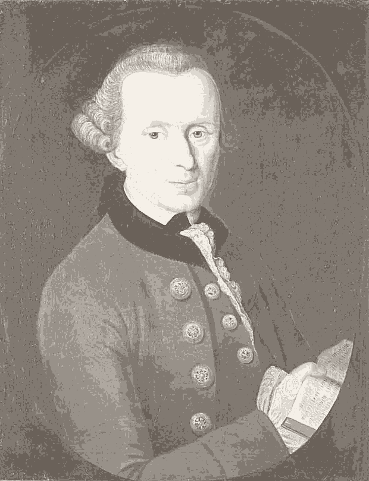
:::

::: {.portrait-body}
> "Treat humanity, whether in your own person or in the person of any other, always at the same time as an end, never merely as a means."

> "无论是对你自己的人性，还是对他人的人性，在任何时候都要同时当作目的，而绝不仅仅当作手段。"

**Source**: Immanuel Kant, *Groundwork of the Metaphysics of Morals*（《道德形而上学奠基》）(1785).
:::
::::
:::

Every tool in this course — opportunity cost, marginal analysis, incentive design — is a means. **People are always the end.**

## Human–AI Collaboration Card

::: ai-card
🎭 Role: Socratic Mirror（苏格拉底之镜）
Trigger: when you ask "is this right?"

**Challenge question**: Marshall defined economics as "a study of mankind in the ordinary business of life." But his map simplifies — what complexities of real managerial decisions does the map hide? Give your own answer first, then let AI only ask you questions (no answers).

> Remember: **Human produces → AI challenges → Human adjudicates.**
:::

Prompts to bring to the mirror:

- Take your answer to the Bob road-map question, then ask the mirror to attack the assumption behind it.
- Take your Honda Civic reasoning, then let the mirror ask why the 2,000 Yuan felt relevant.
- Take your view on CEO pay, then let the mirror find the hidden interest the pay package serves.
- "You cannot observe a teammate's effort — should group work still be graded by the outcome?"
- "When an AI agent books, buys, and negotiates for you — who is the principal, who is the agent, and what is the contract?"

The `/socratic-mirror` skill in the course pack implements this card. See the [Human–AI Collaboration Protocol](ai-protocol.qmd) and the [AI Learning Skills](../skills.qmd) page for the other sparring roles and workflow skills.

## Readings

### Core Readings

- Marshall（马歇尔）, *Principles of Economics*（《经济学原理》）(1920), Book I, Ch. II–III
- Smith（斯密）, *The Wealth of Nations*（《国富论》）(1776), Book I, Ch. 2
- Knight（奈特）, *Risk, Uncertainty and Profit*（《风险、不确定性与利润》）(1921), Ch. I–II
- Buchanan（布坎南）, *Cost and Choice*（《成本与选择》）(1969), Ch. 1
- Thomas & Maurice（托马斯与莫里斯）, *Managerial Economics*（《管理经济学》）(12th ed.), Chapter 1
- Baye & Prince, *Managerial Economics* (10th ed.), Chapter 1
- Dean（迪恩）, *Managerial Economics*（《管理经济学》）(1951), Preface — the book that named the discipline
- Machlup（马赫卢普）, "Theories of the Firm: Marginalist, Behavioral, Managerial" (1967), *American Economic Review* 57(1): 1–33

### Readings: Information and Contract Theory

- Akerlof（阿克洛夫）, "The Market for Lemons" (1970), *Quarterly Journal of Economics* 84(3): 488–500
- Spence（斯彭斯）, "Job Market Signaling" (1973), *Quarterly Journal of Economics* 87(3): 355–374
- Rothschild & Stiglitz（罗斯柴尔德与斯蒂格利茨）, "Equilibrium in Competitive Insurance Markets" (1976), *QJE* 90(4): 629–649
- Jensen & Meckling（詹森与麦克林）, "Theory of the Firm: Managerial Behavior, Agency Costs and Ownership Structure" (1976), *Journal of Financial Economics* 3(4): 305–360
- Holmström（霍姆斯特姆）, "Moral Hazard and Observability" (1979), *Bell Journal of Economics* 10(1): 74–91
- Grossman & Hart（格罗斯曼与哈特）, "The Costs and Benefits of Ownership" (1986), *Journal of Political Economy* 94(4): 691–719


